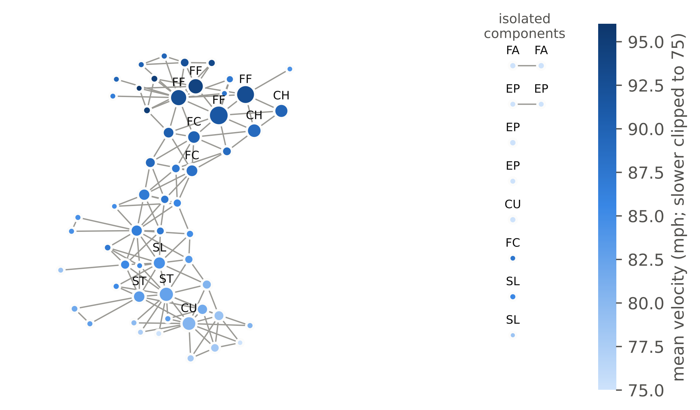

# The Shape of Pitch Space

Master's thesis (Miami University, Department of Mathematics) applying the
Mapper algorithm from topological data analysis to MLB pitch data. The
question is whether pitch types are separate groups or regions of one
connected space, and what that means for grading a pitch within its label.

- **Paper:** [`docs/paper/paper_final.tex`](docs/paper/paper_final.tex)
- **Talk:** [`docs/presentation/presi.tex`](docs/presentation/presi.tex)
- **[Live demo: interactive Mapper graph, colored by pitch type](https://willpaz16.github.io/tda-pitch-clustering/results/mapper_pitch_types_colored.html)**



## Findings

The Mapper graph is fit on 3,943 pitch shapes, one average per pitcher per
pitch type, from 721,799 pitches in the 2025 season. Every feature the graph
shows is tested against null models before it counts.

| Mapper step | On our data |
|---|---|
| point cloud | 3,943 pitch shapes in R⁹ |
| coordinates | velocity, horizontal and vertical movement, spin rate, spin axis as (cos, sin), extension, release x and z (standardized) |
| lens | PCA to 2-D (PC1 38.5%, PC2 21.0% of variance) |
| cover | 10 × 10 intervals, 30% overlap |
| clustering | DBSCAN, ε = 1.0, M = 4 |

- **A Mapper graph is a picture to test, not a result.** The graph's
  curveball-to-fastball ordering holds in every parameter choice and lens,
  but both null models reproduce it every time. It shows how velocity,
  movement, and spin vary together, not hidden structure.
- **One continuum.** Apart from the slowest pitches (eephus pitches and
  position players pitching), pitch shapes form one connected space with no
  more gaps or loops than a Gaussian with the same covariance.
- **The graph's loops are not real.** The graph has 86 independent cycles,
  but the full nerve of the cover keeps only 1. Across 27 parameter choices
  the graph ranges from 33 to 147, while the nerve stays at 0 to 4.
  Persistent homology finds no persistent loop.
- **Three dense regions.** Single pitches pile up around fastballs, breaking
  balls, and offspeed pitches, matching Maloof et al. (2026) for college
  pitches.
- **Labels cut a continuum.** About a tenth of the shapes we could test sit on
  a label boundary (168 of 1,525 in 2025, 150 of 1,565 in 2026). Grading them
  under the neighboring label moves a Stuff+-style grade by a median of 11.5
  points in 2025 and 9.2 in 2026, in seasons the models never saw. In 2025,
  96% of these shifts exceed twice the grade's own sampling error, and a
  model-free check agrees: ranking a pitch's actual swinging-strike rate
  under each label moves its percentile by a median of 17 points in both
  seasons.

## Setup

```bash
python -m pip install -r requirements.txt
```

Statcast season pulls are not in the repo. The scripts that need one take a
`statcast_<season>.parquet` path, made with pybaseball, regular season and
postseason only:

```python
from pybaseball import statcast
df = statcast("2025-03-28", "2025-11-04")
df[df.game_type != "S"].to_parquet("statcast_2025.parquet")
```

## Reproducing the paper

Every number in the paper is a macro in `docs/paper/numbers.tex`, and every
figure comes from one script, both built from the saved outputs in `data/`
and `models/`, so no Statcast pull is needed for this step.

```bash
python src/viz/paper_numbers.py      # writes docs/paper/numbers.tex
python src/viz/thesis_figures.py     # writes docs/presentation/figures/
```

Paper and talk (BibTeX backend, bibliography in `docs/lit_review/references.bib`):

```bash
cd docs/paper && pdflatex paper_final && bibtex paper_final && pdflatex paper_final && pdflatex paper_final
cd docs/presentation && pdflatex presi && bibtex presi && pdflatex presi && pdflatex presi
```

## Pipeline

1. `notebooks/TDA_Pitch_Clustering.ipynb` fits the Mapper model and saves
   `models/tda_mapper_model.pkl`.
2. Shape tests in `src/tda/`: `mapper_stability.py` (parameter grid,
   subsamples, four lenses, nulls), `nerve_homology.py` (graph vs. nerve
   loops), `persistence_check.py`, `density_peaks.py`,
   `flight_space_check.py`, `sample_size_check.py`, and `circle_example.py`
   (the positive control).
3. Stuff+-style models in `src/stuffplus/`: `retrain_xwoba_miss_chase.py`
   trains the CatBoost models on 2022 to 2024, and
   `stuff_plus_calculator.py` grades pitches.
4. Consequences: `src/stuffplus/label_sensitivity.py` (boundary pitches) and
   `src/tda/pitch_design_neighborhood.py` (the pitch-design illustration).
5. `src/viz/paper_numbers.py` and `src/viz/thesis_figures.py`, as above.

Each script's docstring ends with a `Paper (docs/paper/paper_final.tex):`
line naming the section, table, or figure it backs.

## Layout

- `src/tda/`: Mapper fitting, classification, and the shape tests
- `src/stuffplus/`: Stuff+-style models and label sensitivity
- `src/viz/`: paper numbers and figures
- `src/lit/`: bibliography and citation-ledger tooling
- `src/archive/`: earlier exploration not used in the paper or talk (see its README)
- `notebooks/`: model-building notebooks
- `models/`, `data/`, `results/`: trained models, saved outputs, and the interactive graph
- `docs/`: the paper, the talk, the literature review, and methodology notes
  ([`METHODOLOGY_REVIEW.md`](docs/METHODOLOGY_REVIEW.md),
  [`DISCOVERY_FINDINGS.md`](docs/DISCOVERY_FINDINGS.md))

## How this was built (AI assistance)

I developed this project with help from Claude, Anthropic's AI assistant,
used through Claude Code, for analysis code, documentation, the literature
search, and outlining. Commits where Claude helped are marked
`Co-Authored-By: Claude`. I set the research questions and scope, made the
methodological decisions, and reviewed every result.

Because AI output can be confidently wrong, the work is built around
verification rather than trust:

- Every structural claim is tested against null models and across
  parameters, subsamples, and lenses before it counts as a finding. Several
  early findings were dropped this way.
- The literature review ([`docs/lit_review/`](docs/lit_review/)) accepts a
  citation only after its metadata matches a registry record (Crossref,
  DataCite, arXiv, or the publisher) and the claim is confirmed at an exact
  page of the source. I read every source before it went into the paper or
  the talk. `src/lit/verify_citations.py` rechecks the ledger automatically.

## License

MIT, see [LICENSE](LICENSE).
